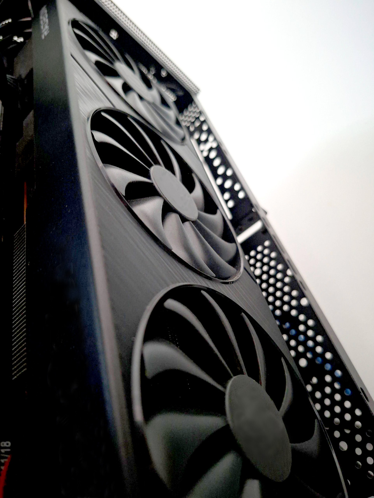

# Local LLM on an RX 6800: Qwen 3.8 27B at 3-bit

I run **Qwen3.8-27B-UD-IQ3\_S** (Unsloth's 3-bit build) as my local coding model on a single 16 GB Radeon RX 6800. It's one of the better coding models that fits, and its hybrid attention design leaves more room for context than any other 27B-class model. As of late 2026, is it the perfect model for this GPU? Read more to find out.

_Note: this is a practical, beginner-friendly article. Not a deep dive for AI or ML engineers. Some LLM tokens were used in the creation of this article._

## The goal

I want locally hosted model for mainly two reasons:
1. **Agentic coding.** An assistant in VS Code (ideally) or any other editor that reads several files, plans a change, edits them, run tests, and fixes errors.
2. Nice to have: **General-purpose Q&A.** Quick questions like "Explain about the offside rule in football", or "Who are the stakeholders of company X?".&#32;
3. Privacy FTW.
   
## The constraints

The hardware is a mid-range 2020 gaming PC, repurposed as a model server.

<table>
<tr>
<td rowspan="8" width="250">Look at that thick, big slab of electricity-sucking, environmentally unfriendly rendering power</td>
<th>Component</th><th>Spec</th><th>Note</th>
</tr>
<tr><td>GPU</td><td>Radeon RX 6800, 16 GB GDDR6, 512 GB/s bandwidth</td><td>16 GB is the hard ceiling for model + context</td></tr>
<tr><td>CPU</td><td>Ryzen 5 5600X</td><td>No integrated graphics</td></tr>
<tr><td>RAM</td><td>16 GB DDR4</td><td>Too little to offload chunks of a model</td></tr>
<tr><td>Motherboard</td><td>MSI B450i AC</td><td>2 RAM slots, 1 PCIe slot</td></tr>
<tr><td>Storage</td><td>SSD</td><td>Just enough</td></tr>
<tr><td>PSU</td><td>Cooler Master V SFX 750</td><td>Top tier SFX PSU. 750 watt is more than enough</td></tr>
<tr><td>OS</td><td>Windows 11</td><td>Vulkan or ROCm (HIP) backends; Windows can silently spill VRAM into system RAM</td></tr>
</table>

## What actually decides fit and speed

Three numbers on a model card predict almost everything on this card.

1. **Fit = total parameters × bits per weight ÷ 8, plus context.** Weights, KV cache and working buffers must all stay under about \~15.3 GB.
2. **Output speed = bandwidth ÷ bytes read per token.** Bytes per token = *active* parameters × bits ÷ 8. On 512 GB/s you get roughly 50–70% of that theoretical maximum.
3. **Context cost per token.** Normal attention stores a KV entry for every layer. Hybrid designs that use linear attention in most layers store far less.

## The candidates

Several models were considered. Each is shown at its usual build (4-bit, or MXFP4 for gpt-oss). Speeds are estimated based on the RX 6800 architecture and limitations.

| Model | Type | Size on 16 GB | Context left for an agent | Output speed (RX 6800) | Note |
| --- | --- | --- | --- | --- | --- |
| [Qwen3.8-27B](https://huggingface.co/Qwen/Qwen3.8-27B) | 27B dense, hybrid attention | \~16.8 GB at Q4: doesn't fit | None without offloading to RAM | Slow (dense, spills to DDR4) | Strongest coder, but too big at 4-bit |
| [gpt-oss-20b](https://huggingface.co/openai/gpt-oss-20b) | 21B MoE, 3.6B active | \~13 GB at MXFP4 | \~32K+ | \~70–120 tok/s | Fast all-rounder; weak at long agent tasks |
| [Devstral Small 2](https://huggingface.co/mistralai/Devstral-Small-2-24B-Instruct-2512) | 24B dense | \~14.7 GB at Q4 | 4–8K | Slow (dense) | Strong agent coder; context too tight |

The dense models win on quality. But at its usual size, the best coder here, Qwen 3.8, doesn't fit at all.

## Benchmarks

There's not much benchmark that covers all these models equally. Here's one; the [Artificial Analysis Intelligence Index](https://artificialanalysis.ai/models/qwen3-8-27b-medium).  It blends agentic coding (Terminal-Bench v2.1, SciCode) with knowledge and reasoning.&#32;

| Model | Intelligence Index (v4.1) |
| --- | --- |
| [Qwen3.8-27B](https://artificialanalysis.ai/models/qwen3-8-27b-medium) (highest reasoning) | 52 |
| [Qwen3.8-27B](https://artificialanalysis.ai/models/qwen3-8-27b-medium) (medium reasoning) | 44 |
| [Qwen3.8-27B](https://artificialanalysis.ai/models/qwen3-8-27b-non-reasoning) (no reasoning) | 35 |
| [Devstral Small 2](https://artificialanalysis.ai/models/comparisons/devstral-small-2-vs-devstral-2) | 17 |
| [gpt-oss-20b](https://artificialanalysis.ai/models/gpt-oss-20b) (high) | 15 |

The makers' own coding benchmarks add detail, but they use different tests and setups, so they can't be compared directly:

| Benchmark | Qwen3.8-27B | gpt-oss-20b (high) | Devstral Small 2 | Run by |
| --- | --- | --- | --- | --- |
| SWE-bench Verified | — | 60.7% | 68.0% | Each maker |
| SWE-bench Pro (harder) | 61.7% | — | — | Qwen |
| Terminal-Bench 2.1 | 73.0% | — | — | Qwen |
| LiveCodeBench v6 | 90.3% | — | — | Each maker |
| LiveCodeBench | — | 77.7% | 34.8% | Artificial Analysis |
| Terminal-Bench Hard | — | 10.6% | 16.7% | Artificial Analysis |
| SWE-bench (Vals.ai) | 86.0% | — | — | Vals.ai |

Based on these benchmark, it's easy to see that Qwen 3.8 excels on the task better than the others.

Note:

- These numbers are for full-precision models. A 3-bit build loses some of this, most visibly on long multi-step tasks.
- The Intelligence Index gets new versions. All three scores above come from version 4.1; newer versions re-score every model.

## A middle ground: going 3-bit with Qwen 3.8 27B UD-IQ3\_S

We now know that Qwen 3.8 27B is the best coder of the three, but its usual 4-bit build doesn't fit in 16 GB. So here comes Unsloth's 3-bit **UD-IQ3\_S** variant - it's the sweet spot with decent room for context, and keeps most of the model's quality.

How each build of Qwen 3.8 27B fits on the RX 6800 (about 15.3 GB usable, 8-bit KV cache, vision on):

| Build | Weights | Context that fits | Trade-off |
| --- | --- | --- | --- |
| Q4\_K\_M (usual) | \~16.8 GB | None | Doesn't fit |
| Q3\_K\_L | \~14.6 GB | None | Doesn't fit with vision on |
| Q3\_K\_M | \~13.5 GB | Almost none | Fits, but no room for an agent to work |
| **UD-IQ3\_S (chosen)** | **\~11.8 GB** | **\~32K to \~****60K** | **Best balance of quality and context** |
| Q2\_K | \~10.9 GB | \~88K | More context, but noticeable quality drop; reasoning starts to loop |

UD-IQ3\_S wins for three reasons:

**1. The strongest coder that fits** based on the benchmarks above.&#32;

**2. A tiny KV cache, thanks to hybrid attention.** Only 16 of its 64 layers use full attention. Context costs about 64 KiB per token with a 16-bit cache, or 34 KiB with an 8-bit cache.

**3. 3-bit is good enough.** A good 3-bit build of a strong 27B is still much better than a weaker model at 4-bit.

The VRAM budget on the server:

| Item | Size |
| --- | --- |
| Weights (UD-IQ3\_S) | \~11.8 GB |
| Vision projector (mmproj) | \~0.9 GB |
| DeltaNet state (1 slot) | \~0.15 GB |
| Working buffers (`-ub 512`) | \~1.0 GB |
| KV cache at 32K, 8-bit | \~1.05 GB |
| **Total** | **\~14.9 GB of \~15.3 GB usable** |

## The trade-offs

- **Speed.** 18–28 tok/s is not exactly fast.&#32;
- **Thinking time.** Qwen 3.8 reasons before answering. You can try to turn thinking off for quick edits and keep it on for harder work.
- **3-bit errors compound.** Over a 30-step agent run, small quantization errors show up as the odd malformed tool call or repeated command.
- Relatively slow prompt reading.&#32;
- **Long contexts get less reliable.** It works best with 32–64K of relevant context, not 150K of everything. I keep agent tasks scoped: name the files, plan first, one sub-task per session.

## The setup

**Back-end server**

The server runs [llama.cpp](https://github.com/ggml-org/llama.cpp) (Vulkan build) on Windows 11. I created a small batch script to pass these custom parameters to achieve the goals (set context size, flash attention etc). Run this batch script instead of the llama Windows app.

```
llama-server.exe 
  -m C:\llm\models\Qwen3.8-27B-UD-IQ3_S.gguf 
  --mmproj C:\llm\models\mmproj-BF16.gguf 
  -ngl 99 
  -fa on 
  -np 1 
  -c 32768 -ctk q8_0 -ctv q8_0 
  -ub 512 
  --jinja   
  ... 
```

| Flag | What it does |
| --- | --- |
| `-ngl 99` | Every layer on the GPU |
| `-fa on` | Flash attention; required for a quantized cache |
| `-np 1` | One slot, so the DeltaNet state isn't duplicated |
| `-c 32768` | 32K context; fits alongside vision and `-ub 512` |
| `-ctk q8_0 -ctv q8_0` | 8-bit KV cache: half the memory, near-zero quality loss |
| `-ub 512` | Bigger prompt-reading chunks: faster prompt reading for agents, at \~1 GB of buffer. `-ub 256` would free \~0.5 GB for about 48K of context instead |
| `--jinja` | The model's own chat template, needed for tool calls |

**Front-end client**

You can use anything for the client. I personally use AnythingLLM as it's relatively easy to install and use (the PC and the tool may be used by non-technical person as well). For the client side connection settings to the server, look for something like "OpenAI-compatible REST API".

If the client is on a separate computer (or phone), you'll need to add additional param on the llama.cpp so it can accept connection from various IPs.

**!!! important: your client may send its own parameters to the back-end**, which might overwrite the custom flags we set on the back-end batch script earlier. So don't forget to check the settings on the client side as well.

## Result and Observation

I won't write about benchmark numbers as you can get those from many LLM benchmark sites on the internet. What I write below are based on what I observe.&#32;&#32;

Pros

- Taking into account all the trade-offs, Qwen 3.8 27B behaves as predicted: strong on logical reasoning, good on popular programming languages, and usable on agentic coding. But make sure to break down an scope the big tasks properly.

Cons

- I'm not sure why but Qwen 3.8 27B seems to have tendency to hallucinate when being asked about generic questions. For example, when I ask about the biography of a certain basketball player, Qwen 3.8 27B wrote that this player once played for club X (which is wrong). Asking about a football player biography gave similar problem.&#32;
- The context is obviously limited, and you'll likely hit the limit when doing more tedious task like browser automation MCP. Do consider allocating bigger context or use other models if that's your primary use case.
- On RX 6800, execution is not exactly fast.

## What's next

I may try to tinker with **Multi-token prediction (MTP).**  Some reported speed-ups of 33–145% on consumer GPUs with MTP enabled. It costs about 1.4 GB of VRAM though, so with vision enabled, context drops to roughly 15–20K. It's a trade-off between speed VS capacity.

**A 24 GB card.** A used RTX 3090 or an RX 7900 XTX (\~940–960 GB/s, with matrix cores) would give about 1.8× the output speed. Unfortunately I have no 💸💸💸

Considering Qwen 3.8 27B's hallucination tendency, I might use another model for real-world Q&A purposes and keep the Qwen for coding (or other technical tasks).

## Sources

- [Qwen3.8-27B model card – Hugging Face](https://huggingface.co/Qwen/Qwen3.8-27B)
- [Qwen 3.8 27B benchmarks and VRAM – MorphLLM](https://www.morphllm.com/qwen-3-8)
- [Qwen3.8-27B scores – BenchLM](https://benchlm.ai/md/models/qwen3-8-27b.md)
- [Run Qwen3.8-27B locally (architecture and KV cache) – Techplained](https://www.techplained.com/run-qwen-3-8-27b-locally)
- [Qwen3.8-27B GGUF (KV cache table) – bowmanslayer](https://huggingface.co/bowmanslayer/Qwen3.8-27B-GGUF)
- [gpt-oss-120b & gpt-oss-20b model card – arXiv](https://arxiv.org/abs/2508.10925)
- [In harmony with gpt-oss (reproduction, leaderboard gaps) – arXiv](https://arxiv.org/abs/2604.00362)
- [Devstral Small 2 model card – Hugging Face](https://huggingface.co/mistralai/Devstral-Small-2-24B-Instruct-2512)
- [Terminal-Bench Hard leaderboard (Artificial Analysis data) – MEO Advisors](https://meoadvisors.com/learn/rankings/benchmark-terminalbench_hard/)
- [Best Local LLMs for 16GB VRAM in 2026 – RunAIHome](https://www.runaihome.com/blog/best-local-llm-16gb-vram-2026/)
- [qwen38-mtp: MTP speed-ups for Qwen3.8-27B – GitHub](https://github.com/sudoingX/qwen38-mtp)
- [Qwen3.8 27B – Artificial Analysis](https://artificialanalysis.ai/models/qwen3-8-27b-medium)
- [Devstral Small 2 vs Devstral 2 – Artificial Analysis](https://artificialanalysis.ai/models/comparisons/devstral-small-2-vs-devstral-2)
- [gpt-oss-20b (high) – Artificial Analysis](https://artificialanalysis.ai/models/gpt-oss-20b)
- [Qwen2.5-32B-Instruct config.json – Hugging Face](https://huggingface.co/Qwen/Qwen2.5-32B-Instruct/blob/main/config.json)
